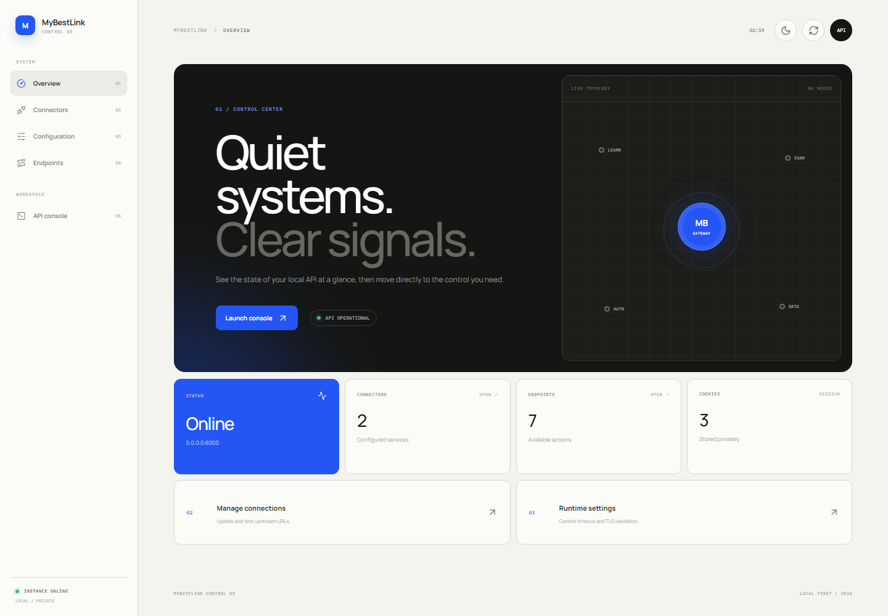

# MyBestLink API

API tidak resmi berbasis `aiohttp` yang mengubah halaman MyBest/BSI menjadi respons JSON untuk dashboard, jadwal kuliah, jadwal pengganti, jadwal ujian, dan validasi lokasi.

> Proyek ini bukan produk resmi BSI. Gunakan hanya dengan akun dan data yang memang berhak Anda akses.

## Preview control panel

<picture>
  <source media="(prefers-color-scheme: dark)" srcset="docs/assets/control-panel-dark.png">
  
</picture>

Preview otomatis mengikuti tema GitHub. Gambar terang dan gelap juga tersedia di
[`docs/assets`](docs/assets). Dokumentasi UI/UX lengkap tersedia di
[docs/CONTROL_PANEL.md](docs/CONTROL_PANEL.md).

## Fitur

- Login ke `elearning.bsi.ac.id`, termasuk captcha aritmetika sederhana.
- Mengambil profil dashboard.
- Mengambil jadwal kuliah dan jadwal pengganti.
- Mengikuti hand-off autentikasi ke portal ujian secara aman.
- Mengambil jadwal UTS/UAS dan mengirim validasi lokasi.
- Timeout request, verifikasi TLS default, validasi redirect, error JSON, health check, dan shutdown session yang rapi.
- Cookie disimpan sebagai JSON, bukan `pickle`.
- Web control panel responsif dengan halaman terpisah, API console, tema
  terang/gelap, dan animasi yang menghormati preferensi reduced motion.

## Persyaratan

- Python 3.11 atau lebih baru.
- Koneksi ke portal BSI.

## Instalasi

```bash
python -m venv .venv
source .venv/Scripts/activate   # Git Bash di Windows
python -m pip install -r requirements.txt
```

Untuk tool pengembangan:

```bash
python -m pip install -r requirements-dev.txt
```

## Menjalankan server

```bash
python main.py
```

Server default berjalan pada `http://0.0.0.0:8000`. Untuk membatasi akses hanya dari komputer lokal:

```bash
MYBESTLINK_HOST=127.0.0.1 python main.py
```

Cek server:

```bash
curl http://127.0.0.1:8000/health
```

Respons:

```json
{"status":"ok"}
```

## Control panel

Control panel tersedia di `http://127.0.0.1:8000/cp`. Antarmuka memakai halaman
terpisah agar setiap layar fokus pada satu pekerjaan:

| Halaman | URL | Fungsi |
|---|---|---|
| Overview | `/cp` | Status runtime, host, jumlah connector, endpoint, dan cookie sesi. |
| Connectors | `/cp/connectors` | Mengubah URL eLearning/ujian dan mengetes koneksi upstream. |
| Configuration | `/cp/configuration` | Mengatur timeout request dan verifikasi TLS. |
| Endpoints | `/cp/endpoints` | Melihat method, route, dan deskripsi seluruh endpoint. |
| API console | `/cp/data` | Login, validasi lokasi, menjalankan request, dan membaca hasilnya. |

Perubahan connector dan konfigurasi diterapkan langsung serta disimpan di
`control-panel.json`. Tema mengikuti preferensi sistem pada kunjungan pertama;
tombol tema di header menyimpan pilihan berikutnya di `localStorage`. Layout
beradaptasi menjadi navigation bar horizontal pada layar kecil.

Animasi menggunakan Anime.js untuk page reveal, active navigation, topology,
loading skeleton, dan progress request. Jika browser mengaktifkan
`prefers-reduced-motion: reduce`, transisi non-esensial dinonaktifkan.

## Alur penggunaan

1. Panggil `POST /login` dengan username dan password.
2. Setelah login berhasil, panggil `/dashboard` atau endpoint jadwal.
3. Panggil `POST /cek-lokasi` sebelum jadwal ujian apabila portal ujian mewajibkan lokasi.

Contoh:

```bash
curl -X POST http://127.0.0.1:8000/login \
  -H 'Content-Type: application/json' \
  -d '{"username":"USERNAME","password":"PASSWORD"}'

curl http://127.0.0.1:8000/dashboard
curl http://127.0.0.1:8000/jadwal/kuliah
curl 'http://127.0.0.1:8000/jadwal/ujian?type=uts'
```

Dokumentasi endpoint lengkap tersedia di [docs/ROUTER.md](docs/ROUTER.md). Koleksi Insomnia tersedia di `collections/Insomnia_2025-08-27.yaml`.

## Konfigurasi

Semua konfigurasi dibaca dari environment variable.

| Variable | Default | Keterangan |
|---|---:|---|
| `MYBESTLINK_HOST` | `0.0.0.0` | Interface server. Gunakan `127.0.0.1` untuk akses lokal saja. |
| `MYBESTLINK_PORT` | `8000` | Port HTTP server. |
| `MYBESTLINK_ELEARNING_BASE_URL` | `https://elearning.bsi.ac.id` | Base URL portal elearning. |
| `MYBESTLINK_EXAM_BASE_URL` | `https://ujiankampusa.bsi.ac.id` | Base URL portal ujian. |
| `MYBESTLINK_COOKIE_FILE` | `cookies.json` | Lokasi persistensi cookie sesi. |
| `MYBESTLINK_CONTROL_CONFIG_FILE` | `control-panel.json` | Lokasi konfigurasi yang disimpan oleh control panel. |
| `MYBESTLINK_REQUEST_TIMEOUT` | `30` | Total timeout upstream dalam detik. |
| `MYBESTLINK_VERIFY_SSL` | `true` | Verifikasi sertifikat TLS upstream. |

Nilai boolean yang diterima: `1/0`, `true/false`, `yes/no`, dan `on/off`.

Jangan mematikan `MYBESTLINK_VERIFY_SSL` di production. Opsi `false` hanya disediakan untuk diagnosis sementara pada jaringan lokal yang melakukan inspeksi TLS.

## Testing dan lint

```bash
python -m unittest discover -s tests -v
ruff check .
python -m compileall -q main.py src tests
```

## Struktur

```text
main.py                         application factory dan entry point
src/config.py                   konfigurasi environment
src/middleware/                 logging dan error mapping
src/router/                     registrasi route
src/service/upstream_client.py  lifecycle session dan HTTP upstream
src/service/                    use case/handler API
src/parser/                     parser HTML murni
src/validation.py               validasi input
view/controller.py              controller server-side control panel
view/templates/                 halaman HTML control panel
view/static/                    CSS, JavaScript, tema, dan animasi
tests/                          unit dan HTTP tests
docs/                           dokumentasi endpoint/arsitektur
```

## Catatan sesi dan keamanan

- Satu proses API menyimpan satu sesi upstream. Artinya deployment saat ini ditujukan untuk penggunaan **single-user/personal**, bukan layanan multi-tenant.
- Login baru mengganti sesi login yang sebelumnya aktif pada proses tersebut.
- Cookie sesi tersimpan di `cookies.json`, yang diabaikan Git. Lindungi file ini seperti kredensial.
- API tidak memiliki autentikasi inbound. Jangan mengeksposnya ke internet publik; bind ke `127.0.0.1` atau lindungi dengan reverse proxy dan autentikasi.
- Username/password hanya diteruskan ke portal BSI dan tidak ditulis ke file oleh aplikasi.

## Dokumentasi lain

- [Endpoint API](docs/ROUTER.md)
- [Arsitektur](docs/ARCHITECTURE.md)
- [UI/UX control panel](docs/CONTROL_PANEL.md)
- [English guide](docs/EN.md)
