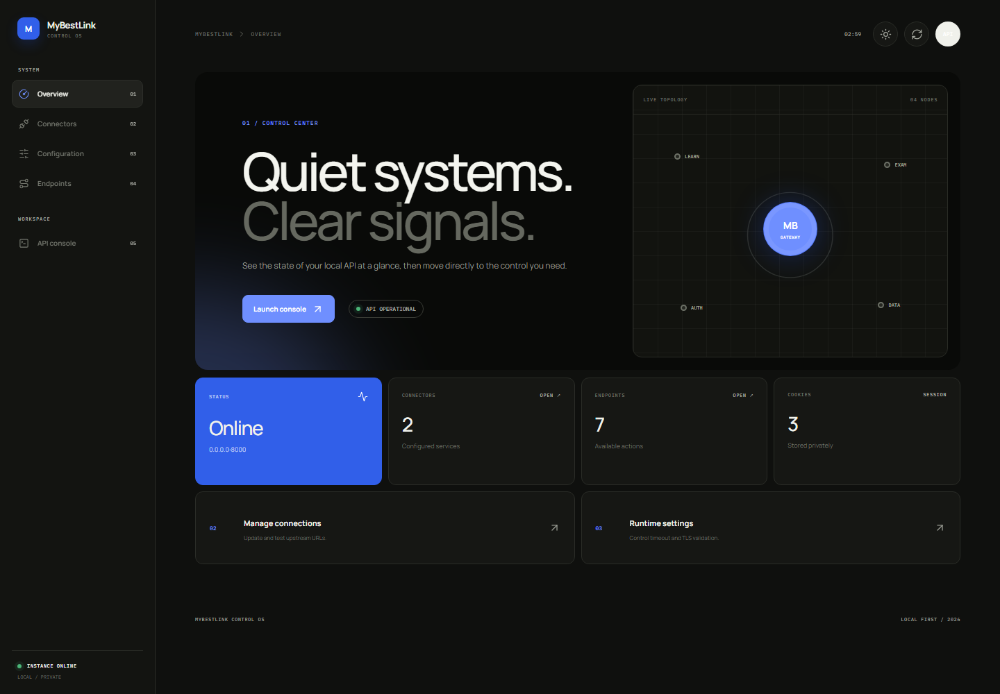

# UI/UX Control Panel

## Ringkasan

Control panel MyBestLink adalah antarmuka lokal untuk memantau runtime,
mengatur koneksi upstream, mengubah konfigurasi, dan mencoba endpoint tanpa
harus mengedit source code atau memakai HTTP client eksternal.

Antarmuka menggunakan visual minimalis dengan canvas netral, aksen cobalt,
tipografi `Manrope` untuk konten, dan `IBM Plex Mono` untuk label sistem. Semua
halaman memakai shell navigasi, komponen, tema, dan pola interaksi yang sama.

## Preview

### Light mode


### Dark mode



Screenshot diambil dari aplikasi yang berjalan pada viewport `1440x1000`.
Nilai runtime dalam gambar berasal dari instance lokal saat preview dibuat.

## Struktur halaman

Control panel tidak menggunakan satu halaman panjang. Setiap pekerjaan memiliki
URL dan template sendiri:

| Halaman | Template | URL | Tujuan |
|---|---|---|---|
| Overview | `view/templates/index.html` | `/cp` | Ringkasan health dan akses cepat. |
| Connectors | `view/templates/connectors.html` | `/cp/connectors` | Edit dan uji upstream service. |
| Configuration | `view/templates/configuration.html` | `/cp/configuration` | Timeout dan TLS policy. |
| Endpoints | `view/templates/endpoints.html` | `/cp/endpoints` | Inventaris public API. |
| API console | `view/templates/data.html` | `/cp/data` | Login, request batch, lokasi, dan response board. |

Route halaman didaftarkan di `src/router/proxy_router.py`, sementara file HTML
disajikan oleh handler di `view/controller.py`.

## Alur penggunaan

### Memantau runtime

1. Buka `/cp`.
2. Periksa status API, alamat bind, jumlah connector, endpoint, dan cookie.
3. Gunakan kartu shortcut untuk masuk ke halaman yang dibutuhkan.

### Mengatur connector

1. Buka `/cp/connectors`.
2. Ubah base URL eLearning atau portal ujian.
3. Gunakan **Test connection** untuk memeriksa status HTTP dan latency.
4. Pilih **Save connectors** untuk menerapkan dan menyimpan perubahan.

### Mengatur runtime

1. Buka `/cp/configuration`.
2. Atur timeout antara 1 sampai 120 detik.
3. Aktifkan verifikasi TLS untuk penggunaan normal.
4. Pilih **Apply configuration**.

### Menggunakan API console

1. Buka `/cp/data` dan mulai portal session dengan kredensial sendiri.
2. Jika diperlukan, isi atau deteksi koordinat untuk validasi lokasi ujian.
3. Jalankan seluruh endpoint melalui **Run all requests**.
4. Periksa status dan payload pada response board.

Kredensial tidak disimpan oleh UI. Hasil request hanya berada pada tab browser
dan dapat dibersihkan melalui **Clear all**.

## Light dan dark mode

`view/static/theme.js` mengatur tema sebelum halaman dirender untuk mengurangi
flash warna yang salah.

Urutan pemilihan tema:

1. Parameter preview `?theme=light` atau `?theme=dark`, jika tersedia.
2. Pilihan pengguna dari `localStorage` dengan key `mybestlink-theme`.
3. Preferensi sistem dari `prefers-color-scheme`.

Tombol matahari/bulan pada header mengubah tema dan menyimpan pilihan. Jika
belum ada pilihan manual, perubahan tema sistem akan langsung diikuti.

Parameter query hanya digunakan sebagai override sementara dan tidak mengubah
preferensi yang tersimpan. Contoh:

```text
http://127.0.0.1:8000/cp?theme=dark
```

## Motion dan accessibility

Animasi berada di `view/static/motion.js` dan menggunakan Anime.js. Motion yang
tersedia meliputi:

- reveal saat halaman atau bagian masuk viewport;
- perpindahan active indicator pada navigasi;
- topology nodes dan gateway pulse;
- skeleton loading untuk data asynchronous;
- progress request batch dan feedback kartu;
- stagger untuk connector, endpoint, dan response cards.

CSS menyediakan fallback `prefers-reduced-motion: reduce`. Tanpa Anime.js,
konten tetap terlihat dan seluruh fitur tetap dapat digunakan. Fokus keyboard
ditandai dengan outline cobalt, status asynchronous memakai teks selain warna,
dan toast menggunakan `aria-live`.

## Responsive behavior

- Desktop: sidebar tetap dan area konten lebar.
- Tablet: hero menjadi satu kolom dan grid statistik menjadi dua kolom.
- Mobile: sidebar berubah menjadi navigation bar horizontal, form menjadi satu
  kolom, dan tabel endpoint dapat digulir secara horizontal.

Breakpoint utama berada pada `1050px`, `850px`, `680px`, dan `480px` di
`view/static/styles.css`.

## Arsitektur frontend

```text
view/
├── controller.py          handler halaman dan control API
├── ui.json                metadata connector dan endpoint
├── templates/             satu template untuk setiap halaman
└── static/
    ├── app.js             controller overview/settings/connectors/endpoints
    ├── data.js            controller API console
    ├── motion.js          animation layer dan reduced-motion handling
    ├── theme.js           theme detection dan persistence
    └── styles.css         design tokens, components, themes, responsive rules
```

Frontend tidak memerlukan build step. Aset disajikan dari `/view/`, tetapi
static route hanya menunjuk ke `view/static`; source Python di `view/controller.py`
tidak dapat diakses sebagai static file.

## Kontrak data UI

Halaman overview, connectors, configuration, dan endpoints mengambil snapshot:

```http
GET /cp/api/config
```

Perubahan connector atau runtime dikirim sebagai object konfigurasi lengkap:

```http
PUT /cp/api/config
Content-Type: application/json
```

Pengujian connector memakai:

```http
POST /cp/api/connectors/test
Content-Type: application/json
```

`view/static/app.js` menggabungkan field yang sedang diedit dengan snapshot
terakhir sehingga halaman terpisah tetap memenuhi kontrak konfigurasi backend.

## Memperbarui screenshot

Jalankan server, lalu ambil preview pada ukuran desktop. Parameter tema membuat
hasil deterministik:

```text
http://127.0.0.1:8000/cp?theme=light
http://127.0.0.1:8000/cp?theme=dark
```

Simpan hasil sebagai:

```text
docs/assets/control-panel-light.png
docs/assets/control-panel-dark.png
```
